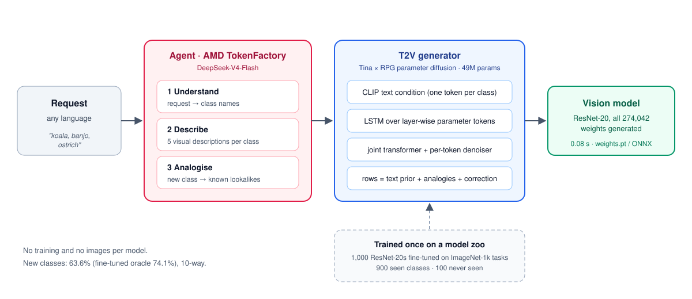

<h1 align="center">T2V · Text to Vision</h1>

<p align="center">
  <b>Describe a classifier in words. Get a working vision model in 0.08 seconds (one T4 GPU).</b><br>
  An agent on AMD TokenFactory reasons about what each class looks like; a diffusion model then writes
  every weight of the network directly. No training and no images per model.
</p>

<p align="center">
  <a href="LICENSE"></a>
  
  
  
  <a href="https://github.com/kalidolinux-sudo/t2v-text-to-vision/releases/tag/1.0"></a>
</p>

<p align="center"></p>

```text
"أبي نموذج يميز بين الكوالا والبانجو والنعامة"            (any language)
  1 understand   → ["koala", "banjo", "ostrich"]
  2 describe     → "koala: Gray, fluffy, tree-dwelling marsupial with large nose and round ears.", …
  3 analogise    → koala never seen?  looks like teddy 50%, wombat 30%, wallaby 20%
  → ResNet-20 with all 274,042 weights generated  →  weights.pt / model.onnx
```

**Contents:** [Results](#t2v-1k-results-on-imagenet-1k) · [How it works](#how-it-works) ·
[Quick start](#quick-start) · [Reproduce](#reproduce) · [Command-line pipeline](#command-line-pipeline) ·
[Repository layout](#repository-layout) · [Limitations](#limitations) · [References](#references) · [How this was built](#how-this-was-built)

## T2V-1K: results on ImageNet-1k

ImageNet-1k at 32×32. The zoo uses **900 classes**. **100 classes are never seen**: 49 drawn at random,
and 51 forming whole semantic groups (sharks and turtles, musical instruments, …) so that no close
relative is left among the seen classes. Each row is 100 test tasks of 10 classes that the zoo never saw.
The oracle is a ResNet-20 actually fine-tuned on the images of each task.

| Test tasks (100 each, 10 classes) | **T2V-1K, generated from text** | Oracle (fine-tuned on images) | Share of oracle | Chance |
|---|---|---|---|---|
| Seen classes, new combinations | **70.0%** | 72.4% | 97% | 10% |
| Half the classes never seen | **64.1%** | 74.9% | 86% | 10% |
| All classes never seen | **63.6%** | 74.1% | 86% | 10% |
| All never seen, whole groups held out | **47.5%** | 64.8% | 73% | 10% |

The run's console log and zoo statistics are in [`results/t2v_1k/`](results/t2v_1k/).

One full ResNet-20 takes **0.079 s** to generate (T4, 5 DDIM steps, fp16). Picking rows from the generic
model's head (Tina's "selection" baseline) scores 69.3% on seen classes and cannot handle new classes at
all.

### What the TokenFactory agent adds

| Prior for classifier rows of new classes | Half new | All new | All new, hard |
|---|---|---|---|
| Ridge map from class text only | 64.0% | 61.2% | **48.3%** |
| + CLIP nearest neighbours (no LLM) | 64.2% | 62.9% | 48.1% |
| **+ TokenFactory visual analogies** | 64.1% | **63.6%** | 47.5% |
| No known-class gate | 64.3% | 60.2% | 44.1% |

- The analogies help most when visually close relatives exist among the seen classes (+2.4 points over
  ridge on random new classes). When a whole group is held out, there is little to draw an analogy
  from, and they do not help. `notebooks/t2v_colab_paired_stats.py` gives paired bootstrap intervals for
  these differences.
- The blend weight between the ridge prior and the analogies is chosen by cross-validation on 100 seen
  classes treated as new, never on test tasks.
- The visual descriptions (5 per class for all 1,000 classes) are written by the same agent. On the
  CIFAR-100 ResNet-20 they added 2.8 to 5.7 points on 30-task tests ([experiment log](docs/EXPERIMENTS.md)).

### What the diagnostics say (`python -m t2v.diagnose`, 50 tasks per split)

- **The model follows the text.** Generated with the wrong class names, accuracy falls to chance
  (9.3%). Reversing the class order gives the same accuracy (69.1% vs 69.3%).
- **The classifier rows are the bottleneck, not the body.** With fine-tuned rows on the generated body,
  new-class accuracy goes from 59.1% to 71.6%. A fine-tuned body under the generated rows adds only 0.5
  to 2 points. The generated body is as close to the right one as the zoo's mean model is.
- **The zoo does carry task-specific body information.** With tail fine-tuning and two-seed model soups,
  task-to-task variation is 27× the seed noise (`zoo analyze`). Most of it is in BatchNorm statistics of
  the last two blocks, and it is worth little accuracy.
- **The known-class gate matters.** It keeps the generated row correction only for classes the
  generator was trained on, and it adds 4.2 points on the hard split. Its threshold (0.9947) is set
  automatically just above the closest pair of different training classes.

### The role of AMD

**AMD TokenFactory is the reasoning core of T2V.** The diffusion model only knows how to turn class
embeddings into weights; everything that makes it an agent runs on TokenFactory (DeepSeek-V4-Flash), both
in the product and when the system was built:

| What TokenFactory does | Without it | Measured effect |
|---|---|---|
| **Understands** a free-form request in any language and turns it into class names | only comma-separated English class lists work | Arabic request → 85.0% on real CIFAR-100 photos (stage 1) |
| **Describes** every class visually (5 descriptions × 1,000 ImageNet classes, and live for new names) | the condition is the bare class name | +2.8 to +5.7 points (CIFAR-100 ResNet-20 ablation, 30 tasks per split) |
| **Analogises**: picks the known classes a never-seen class looks like | rows of new classes come from text alone | +2.4 points on new ImageNet classes over the ridge prior (100 tasks); no gain when whole groups are held out |

At build time TokenFactory wrote 5,000 visual descriptions (5 for each of the 1,000 ImageNet classes) and
200 visual-analogy judgements, all shipped in `data/`. At run time every request goes through it, and so does every class
name it has not described before.

The whole system (1,000-model zoo, 400 test models, generator training, evaluation) was built end to end
on a single Google Colab T4 GPU in 72 minutes (`notebooks/t2v_colab_final_imagenet.py`), with Google Drive
holding checkpoints so finished stages survive disconnects. The code uses only standard PyTorch operations and
ships a ROCm build of the Docker image (`--bf16` is the intended precision on AMD Instinct MI300X), so
moving training onto AMD GPUs is a configuration change.

## How it works

T2V combines two lines of research on generating network weights, and adds an LLM agent:

- **Tina** ([Li et al., 2024](https://arxiv.org/abs/2405.14132)): text-conditioned parameter diffusion
  trained on a "train once, generate for all" model zoo, with classifier-permutation augmentation.
- **RPG** ([Wang et al., 2025](https://arxiv.org/abs/2501.11587)): layer-wise tokenization, a recurrent
  backbone and per-token denoising, which scale generation to hundreds of millions of parameters.

| | Tina | RPG | **T2V** |
|---|---|---|---|
| Condition | class names (CLIP) | task code / LLM embedding | **free-form request → LLM agent → CLIP + visual descriptions** |
| Classifier rows | permutation augmentation | — | **one token per row, tied to its class's text**; row = text prior + generated correction |
| New classes | CLIP text only | — | **ridge prior blended with LLM visual analogies**, known-class gate |
| Scaling | flattened vector (~5K params) | layer-wise tokens + recurrent model | RPG tokenization, Tina conditioning, joint transformer |

1. **Model zoo.** A generic ResNet-20 is trained on 900 ImageNet classes, then fine-tuned (last two blocks,
   two seeds averaged) on 1,000 random tasks of 2–10 classes.
2. **Tokenizer.** Each zoo model becomes a sequence of 1,024-wide parameter tokens: body weights as a
   deviation from the zoo's mean model, and one token per classifier row.
3. **Generator.** A class-set encoder over CLIP embeddings conditions an LSTM over token positions; a joint
   transformer and a per-token MLP denoiser predict clean weights (x₀) in 5 DDIM steps.
4. **Classifier rows.** A ridge map from class text to rows gives a prior; for classes never seen, it is
   blended with the rows of the known classes the agent names as lookalikes; for known classes, the
   generated correction is added on top.
5. **Agent.** DeepSeek-V4-Flash on AMD TokenFactory turns requests into classes, writes visual
   descriptions that enrich the CLIP condition, and proposes the visual analogies.

The full history (CIFAR-100 prototypes, every version, bug and negative result) is in the
[experiment log](docs/EXPERIMENTS.md).

## Quick start

The ImageNet-1k generator `t2v_1k.pt` (198 MB) is attached to the
[T2V-1K release](https://github.com/kalidolinux-sudo/t2v-text-to-vision/releases/tag/1.0) as
`t2v_1k.zip`; the app downloads and unpacks it into `checkpoints/` on first start. The CIFAR-100
generator (`checkpoints/t2v_tinacnn_cifar100.pt`, 30 MB) ships with the code and is used when offline.

```bash
# Docker (CPU); the TokenFactory key is passed at run time and never stored in the image
docker build -t t2v .
docker run -p 7860:7860 -e TOKENFACTORY_API_KEY=... t2v       # then open http://localhost:7860
# AMD GPU (ROCm)
docker build -t t2v --build-arg TORCH_INDEX=https://download.pytorch.org/whl/rocm6.4 .
docker run -p 7860:7860 --device=/dev/kfd --device=/dev/dri --group-add video -e TOKENFACTORY_API_KEY=... t2v
```

Without Docker:

```bash
pip install -r requirements.txt
export TOKENFACTORY_API_KEY=...            # optional; never commit it
export TOKENFACTORY_BASE_URL=https://developer.amd.com.cn/radeon/api/v1
export TOKENFACTORY_MODEL=DeepSeek-V4-Flash
python app.py                              # Gradio demo
python -m t2v.generate --ckpt checkpoints/t2v_1k.pt --prompt "koala, banjo, ostrich, pizza"
```

Without a TokenFactory key everything still runs: requests are split on commas, and the descriptions and
analogies stored in `data/` and in the checkpoint are used.

## Reproduce

Paste [`notebooks/t2v_colab_final_imagenet.py`](notebooks/t2v_colab_final_imagenet.py) into one Google
Colab cell (T4 GPU) and run it. It needs no API key, because the TokenFactory outputs are bundled. It
takes about 72 minutes and saves everything to Google Drive; after a disconnect, rerunning the cell skips the finished zoo and test models (an interrupted generator training restarts). The console log
of the run reported above is in [`results/t2v_1k/`](results/t2v_1k/).

## Command-line pipeline

```bash
pip install -r requirements.txt     # on an AMD GPU, install the ROCm build of PyTorch first

# 1. generic model + model zoo (Tina recipe); shards run in parallel on one GPU
python -m t2v.zoo generic --dataset imagenet32 --split_file data/imagenet_split.json --arch resnet20 --out zoo --amp
for s in 0 1 2 3; do python -m t2v.zoo pmodels --out zoo --n 1000 --min_k 2 --finetune tail:2 --soup 2 --amp \
    --shard $s --num_shards 4 & done; wait
for s in eval_seen eval_unseen eval_novel eval_novel_hard; do python -m t2v.zoo pmodels --out zoo --split $s \
    --n 100 --finetune tail:2 --soup 2 --amp; done

# 2. TokenFactory outputs (already in data/ for ImageNet-1k)
export TOKENFACTORY_API_KEY=...            # never commit it
export TOKENFACTORY_BASE_URL=https://developer.amd.com.cn/radeon/api/v1
export TOKENFACTORY_MODEL=DeepSeek-V4-Flash
python -m t2v.describe --names_from zoo/meta.json --out data/descriptions.json
python -m t2v.neighbors --zoo zoo --descriptions data/descriptions.json --out data/neighbors.json

# 3. generator (--fp16 on T4-class GPUs; --bf16 intended for MI300X)
python -m t2v.train_gen --zoo zoo --out ckpt/generator.pt --denoiser mlp --mlp_hidden 1024 --joint_layers 4 \
    --norm element --head_weight 10 --semantic_prior --descriptions data/descriptions.json \
    --neighbors data/neighbors.json --prompt_ensemble --emb_noise 0.02 --ema 0.999 --cosine --steps 6000

# 4. evaluate and diagnose
python -m t2v.evaluate --ckpt ckpt/generator.pt --zoo zoo --steps 5 --body_noise 0 --gate auto
python -m t2v.diagnose --ckpt ckpt/generator.pt --zoo zoo --body_noise 0

# 5. text → model
python -m t2v.generate --ckpt ckpt/generator.pt --prompt "أبي نموذج يميز بين القطط والكلاب والخيول"
```

`scripts/smoke_test.sh` runs the whole pipeline at toy scale on a CPU, and `pytest` runs the unit tests. Target
architectures: `tina_cnn` (5.4K params), `resnet20` (0.27M), `resnet18` (11M).

## Repository layout

```text
t2v/                    the package
  data.py  zoo.py         datasets, class splits, model zoo (generic model, fine-tuned task models, SNR)
  target.py               target architectures, flattening, classifier-row priors
  tokenizer.py            weights <-> parameter tokens
  generator.py            the T2V diffusion model
  train_gen.py            generator training (semantic prior, neighbour blend, known-class gate)
  generate.py             text -> weights -> PyTorch / ONNX model
  evaluate.py diagnose.py accuracy against baselines; eight inference-only probes
  llm.py describe.py neighbors.py   the TokenFactory agent: parse, describe, analogise
app.py  Dockerfile      Gradio demo; CPU or ROCm container
data/                   ImageNet-1k names and split; TokenFactory descriptions and analogies
notebooks/              one-cell Colab runs (see notebooks/README.md)
results/                logs and diagnostics of the T2V-1K run
docs/                   experiment log and architecture diagram
checkpoints/            CIFAR-100 generator (the ImageNet-1k one comes from the release)
tests/                  unit tests (pytest, CPU, no downloads)
```

## Limitations

- Trained and measured on a T4 GPU; benchmarking the ROCm build on AMD Instinct GPUs is future work.
- The generator itself is trained once, on a model zoo. "No training" applies to each new model, not
  to the system as a whole.
- Images are 32×32, so photos are downscaled heavily, and fine-grained classes (dog breeds, for
  example) are hard.
- New classes far from everything seen (whole held-out groups) reach 73% of the fine-tuned oracle, against
  86% for random new classes.
- The generated network body stays close to the zoo's mean model. The task-specific part of a model is
  carried by its classifier rows.


## References

- Z. Li, L. Gao, C. Wu. *Text-to-Model: Text-Conditioned Neural Network Diffusion for Train-Once-for-All
  Personalization* (Tina). [arXiv:2405.14132](https://arxiv.org/abs/2405.14132)
- K. Wang et al. *Recurrent Diffusion for Large-Scale Parameter Generation* (RPG).
  [arXiv:2501.11587](https://arxiv.org/abs/2501.11587)
- W. Peebles et al. *Learning to Learn with Generative Models of Neural Network Checkpoints* (G.pt).
  [arXiv:2209.12892](https://arxiv.org/abs/2209.12892)
- S. Pratt et al. *What does a platypus look like? Generating customized prompts for zero-shot image
  classification* (CuPL). [arXiv:2209.03320](https://arxiv.org/abs/2209.03320)

## How this was built

T2V was built by its author with the help of AI assistants, and every result in this repository comes
from code that was actually run (logs in [`results/`](results/)):

- **Gemini** (Google's latest thinking model) helped formulate the experiments and assisted with the
  research.
- **Claude** (Anthropic) wrote much of the code and documentation under the author's direction.
- **The author** directed the project, ran the training on Google Colab, and reviewed the code, the
  experiments and the claims made here.
- **AMD TokenFactory** (DeepSeek-V4-Flash) is part of the system itself, as described
  [above](#the-role-of-amd).

## License

[MIT](LICENSE). Built for the AMD Developer Hackathon: ACT III.
